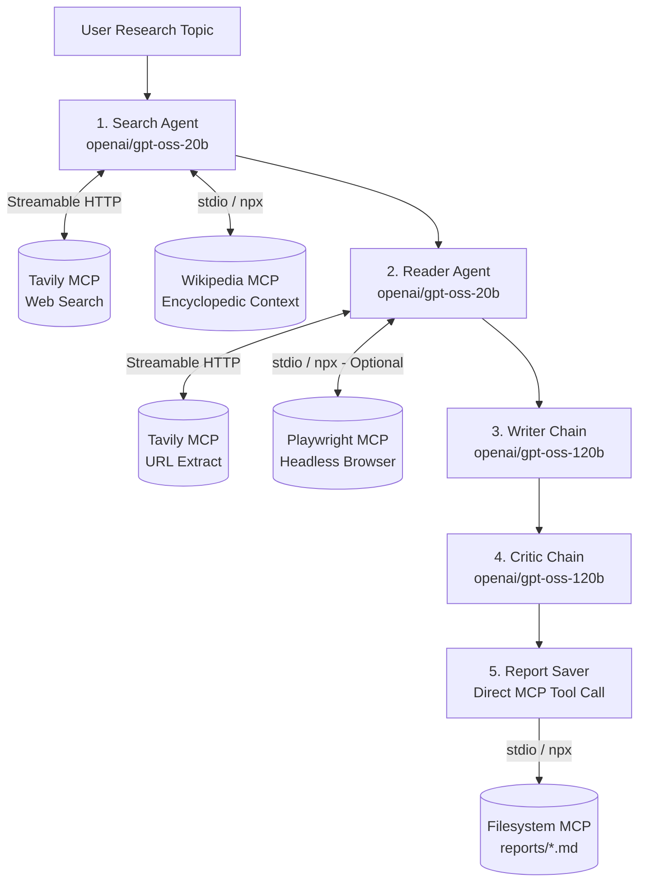

# ResearchMind — MCP-Powered Multi-Agent AI Research Assistant


**ResearchMind** is a 5-stage multi-agent AI research pipeline built with **Python**, **LangChain**, **Groq API**, and the **Model Context Protocol (MCP)**. Instead of hardcoding custom scraping or search functions, ResearchMind dynamically discovers and invokes tools from **4 modular MCP servers** (Tavily, Wikipedia, Playwright, and Filesystem) to gather live web data, extract deep content, draft structured reports, critique its own work, and save Markdown outputs to disk.

---

## Architecture



---

## MCP Servers Integrated

All 4 servers are registered declaratively in `mcp.json` and loaded at runtime via `langchain-mcp-adapters`:

| MCP Server | Transport | Package / Endpoint | Role in Pipeline |
| :--- | :--- | :--- | :--- |
| **Tavily MCP** | Remote HTTP | `https://mcp.tavily.com/mcp/` | Live web search & structured URL extraction |
| **Wikipedia MCP** | Local `stdio` | `npx -y wikipedia-mcp` | Encyclopedic background & factual verification |
| **Playwright MCP** | Local `stdio` | `npx -y @playwright/mcp@latest --headless` | Optional headless Chromium fallback for JS-heavy pages |
| **Filesystem MCP** | Local `stdio` | `npx -y @modelcontextprotocol/server-filesystem` | Sandboxed Markdown report saving into `reports/` |

---

## Key Engineering Highlights

- **Role-Based Model Routing:** Uses `openai/gpt-oss-20b` (`temperature=0`) for fast, deterministic tool calling in the Search and Reader agents, and `openai/gpt-oss-120b` (`temperature=0.3`) for high-reasoning report synthesis and LLM-as-a-Judge critique.
- **Token-Budget Guardrails:** Includes a custom `cap_mcp_tool()` async wrapper, selective tool filtering, and `DEFAULT_PARAMETERS` headers to prevent `413` token-per-minute (TPM) overflows on Groq's free tier.
- **Secure Config Injection:** Uses `${TAVILY_API_KEY}` and `${REPORTS_DIR}` placeholders inside `mcp.json`, injected dynamically from `.env` at runtime so secrets are never committed to Git.
- **Cross-Platform & Persistent Sessions:** Automatically wraps `npx` with `cmd /c` on Windows and manages persistent async MCP sessions via `AsyncExitStack` to avoid respawning Node processes mid-run.
- **Built-In Observability & Health Checks:** Logs every MCP tool invocation and error live in both CLI and Streamlit, plus includes `test_mcps.py` to independently verify all 4 servers without spending LLM tokens.
---

## Setup & Installation

### Prerequisites
- **Python 3.10+**
- **Node.js & `npx`** (for running local `stdio` MCP servers)
- **Groq API Key** ([console.groq.com](https://console.groq.com/))
- **Tavily API Key** ([tavily.com](https://tavily.com/))

### 1. Clone the Repository
```bash
git clone [https://github.com/mswargwani/](https://github.com/mswargwani/)<your-repo-name>.git
cd <your-repo-name>
```

### 2. Create a Virtual Environment & Install Dependencies
```bash
python -m venv .venv

# Windows (PowerShell)
.\.venv\Scripts\activate

# macOS / Linux
source .venv/bin/activate

pip install -r requirements.txt
```

### 3. Configure Environment Variables
Create a `.env` file in the project root:
```env
GROQ_API_KEY=your_groq_api_key_here
TAVILY_API_KEY=your_tavily_api_key_here
```

---

## Usage

### 1. Verify All 4 MCP Servers (Recommended First Step)
Runs a zero-token health check across Tavily, Wikipedia, Playwright, and Filesystem MCP:
```bash
python test_mcps.py
```

### 2. Run via Streamlit Web UI
```bash
streamlit run app.py
```

### 3. Run via CLI
```bash
python pipeline.py
```

Saved reports (including the Critic Review) are automatically written to the `reports/` directory via Filesystem MCP.

---
